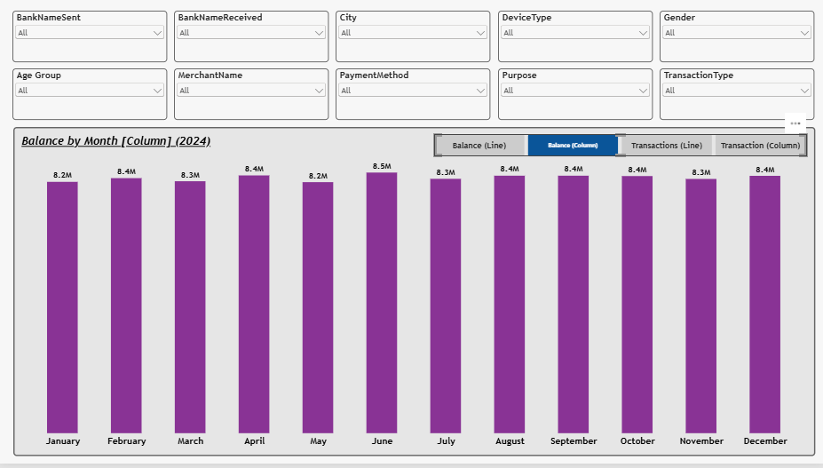
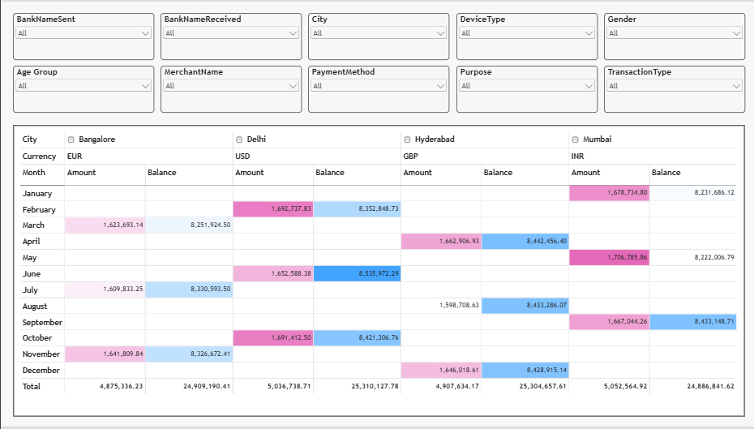

# 💸 UPI Transactions Analytics Dashboard

> An interactive Power BI report for exploring 2024 UPI transaction activity, with a one-click button toggle that switches a single canvas between four different views.


---

## 📑 Table of Contents

- [Overview](#-overview)
- [Highlight Feature: Dynamic View Switcher](#-highlight-feature-dynamic-view-switcher)
- [Dashboard Preview](#-dashboard-preview)
- [Report Pages](#-report-pages)
- [Filters & Slicers](#-filters--slicers)
- [Key Observations](#-key-observations)
- [Tools & Techniques](#-tools--techniques)
- [How to Use](#-how-to-use)
- [Author](#-author)

---

## 📖 Overview

This project analyzes **UPI (Unified Payments Interface) transaction data for 2024**. It is built for fast, flexible exploration: ten slicers let you cut the data by bank, city, device, demographics, merchant, payment method, and more, while a compact two-page layout keeps the story easy to follow.

**What you can do with it:**

- Track monthly **balance** and **transaction** trends across 2024
- Switch between **line** and **column** views without leaving the page
- Compare **amount and balance** by city and month in a matrix
- Filter every visual by any combination of ten dimensions

---

## ✨ Highlight Feature: Dynamic View Switcher

Page 1 uses **navigation buttons** so that one visual area can show four different views. Instead of cluttering the report with four separate charts, the user clicks a button and the same space updates.

| Button | View |
|--------|------|
| **Balance (Line)** | Monthly balance as a smooth area/line chart |
| **Balance (Column)** | Monthly balance as a column chart |
| **Transactions (Line)** | Monthly transactions as a line chart |
| **Transaction (Column)** | Monthly transactions as a column chart |

**Why it matters:**

- 🧹 **Cleaner layout:** one canvas, four visuals
- 🎯 **User-controlled:** viewers pick the chart type and metric that suits them
- 🔗 **Slicer-aware:** the selected view responds to all ten slicers

---

## 🖼 Dashboard Preview

### Page 1: Monthly Trends with View Switcher

**Balance (Line)**


**Balance (Column)**


### Page 2: City-wise Matrix (Amount & Balance)


---

## 📄 Report Pages

### 1️⃣ Monthly Trends (Interactive View Switcher)
- **Balance by Month (2024)**, January to December
- **Four switchable views** controlled by navigation buttons (see above)
- Data labels on every point for quick reading
- Ten slicers shared across the visuals

### 2️⃣ City & Month Matrix
A matrix visual that breaks the data down as follows:

- **Rows:** Month (January to December)
- **Columns:** City → Currency → Amount / Balance
- **Cities:** Bangalore, Delhi, Hyderabad, Mumbai
- **Conditional formatting** (color scales) highlights higher and lower values at a glance
- **Totals** shown per city for both Amount and Balance

---

## 🎛 Filters & Slicers

Both pages share the same set of slicers:

| | | |
|---|---|---|
| `BankNameSent` | `BankNameReceived` | `City` |
| `DeviceType` | `Gender` | `Age Group` |
| `MerchantName` | `PaymentMethod` | `Purpose` |
| `TransactionType` | | |

---

## 💡 Key Observations

- Monthly balance stays in a narrow range of roughly **8.2M to 8.5M** throughout 2024.
- **June** is the peak month (about 8,536K), and **May** is the lowest (about 8,222K). The sharp May-to-June jump is the largest swing in the year.
- Balance dips in **March, May, July, and November**, and recovers strongly in the months after each dip.
- By city, **Mumbai** has the highest total amount (5,052,564.92) and **Delhi** the highest total balance (25,310,127.78).
- City totals are close to each other (about 4.88M to 5.05M in amount), which suggests an even spread of activity.

---

## 🛠 Tools & Techniques

- **Power BI Desktop** for data modelling and report design
- **DAX** for measures (balance, amount, transaction counts)
- **Power Query** for data cleaning and transformation
- **Bookmarks & Buttons** for the dynamic view switcher
- **Matrix visual with conditional formatting** for the city-by-month analysis

> Edit this list to match what you actually used.


## ▶️ How to Use

1. Clone the repository
```bash
   git clone https://github.com/<your-username>/<your-repo>.git
```
2. Install [Power BI Desktop](https://powerbi.microsoft.com/desktop/) (free, Windows only).
3. Open `UPI_Dashboard.pbix`.
4. On **Page 1**, click the buttons at the top right of the chart to switch views.
5. Use the slicers to filter, and open **Page 2** for the city and month matrix.

> 💡 In Power BI Desktop, hold **Ctrl** and click a button to activate it. In the Power BI Service, a normal click works.

---

## 👤 Author

**Sunday Theophilus Oyelami**
GitHub: [@ST-Oyelami](https://github.com/ST-Oyelami)

---

⭐ If you found this project useful, please consider giving it a star.
